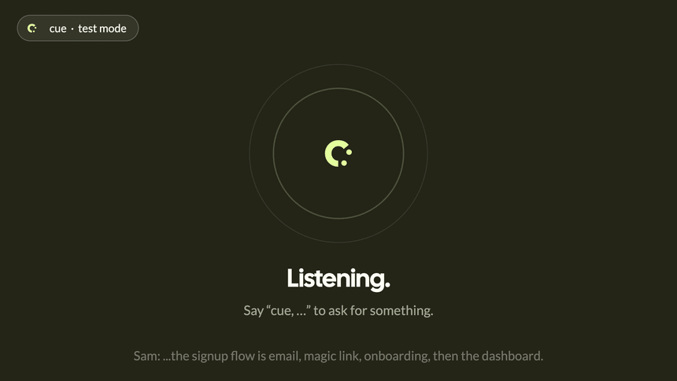
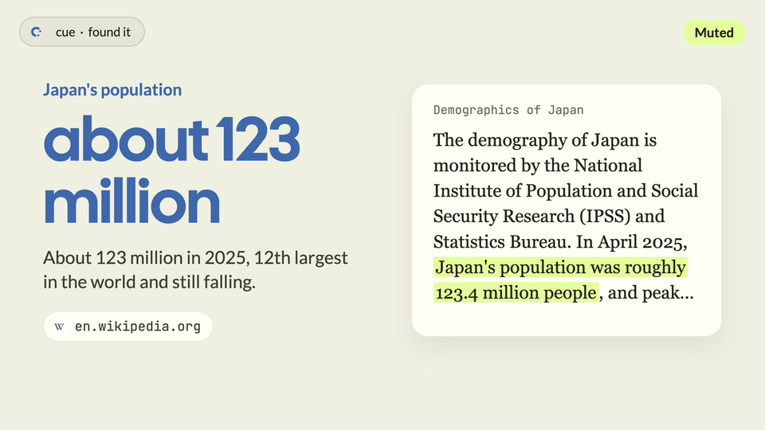
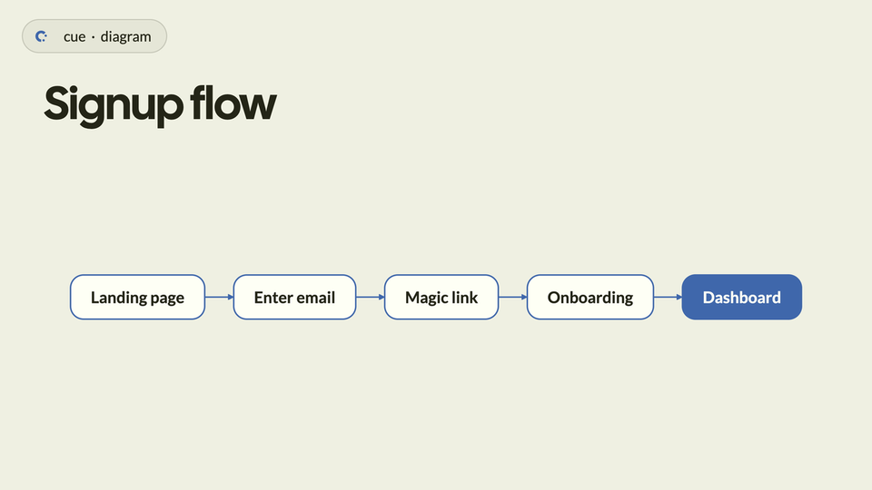
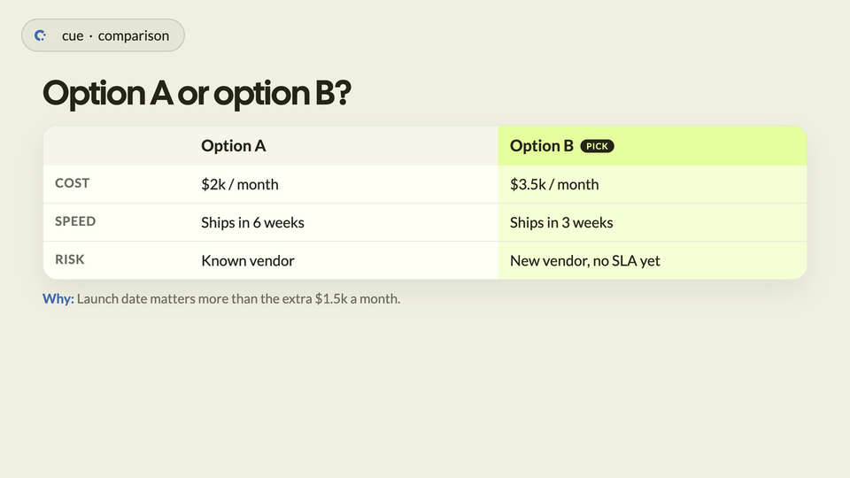
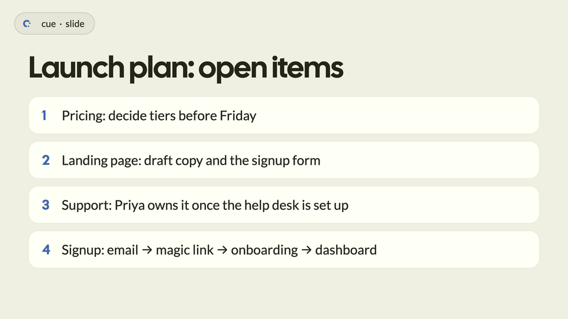
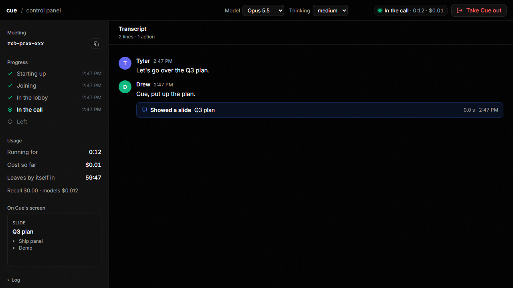
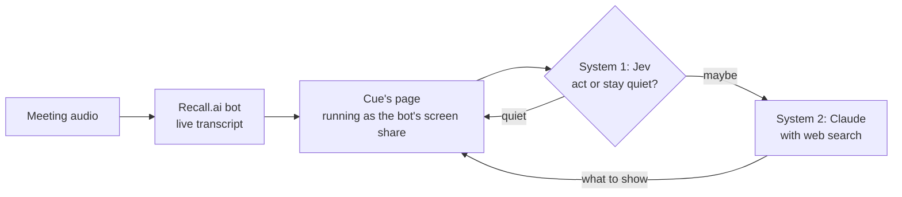

<div align="center">

<picture>
  <source media="(prefers-color-scheme: dark)" srcset="brand/logo/svg/transparent/cue-lockup-cream.svg">
  
</picture>

<br><br>

**The meeting participant that never says a word.**<br>
It listens, and puts what the room needs on screen.

It thinks at two speeds: [Jev](#how-cue-decides-jev-as-system-1) (System 1) decides in a fraction of a second whether to act,<br>and Claude (System 2) decides what to show.

[](https://github.com/a-Fig/cue/actions/workflows/ci.yml) [](package.json) [](LICENSE)

[Try it](#try-it-in-a-minute) &nbsp;·&nbsp; [Put it in a call](#put-it-in-a-call) &nbsp;·&nbsp; [How it works](#how-it-works) &nbsp;·&nbsp; [Jev as System 1](#how-cue-decides-jev-as-system-1) &nbsp;·&nbsp; [Vision](docs/VISION.md)

<br>



<sub>Everything Cue does, it does on its shared screen.</sub>

</div>

---

A question comes up in a meeting and nobody knows the answer.
Someone says "I'll look into it", or stops listening to search.
A plan takes shape out loud, and everyone leaves with a different version of it.

Cue joins the call as a participant and never speaks.
When the room would want to see something, it puts it up: the web page with the answer highlighted, the plan as a slide, the flow as a diagram.
People glance at it when they want to, so it helps without taking a turn in the conversation.

Think of the producer who pulls up the clip mid-podcast while the host keeps talking.
Cue is that producer, for any meeting.

## What it shows

<table>
<tr>
<td width="50%"><br><b>Research.</b> The real page, with the passage that answers the question highlighted. Nobody has to take Cue's word.</td>
<td width="50%"><br><b>Diagrams.</b> A flow described in words becomes a drawing while people are still describing it.</td>
</tr>
<tr>
<td><br><b>Comparisons.</b> Options with prices or trade-offs, side by side, with a pick when the room leans one way.</td>
<td><br><b>Slides and notes.</b> Bullets, a big number, a quote, or the decisions and action items so far.</td>
</tr>
</table>

It also writes one-line captions ("Found it: about $9.2B in 2025, growing ~9% a year."), draws charts, finds photos, plays a YouTube clip or `.mp4` from a timestamp, and pings softly when something you asked for is ready.

## Talk to it, or don't

Cue acts on its own when something comes up that the room would want to see: a question wondered aloud, a guessed number, options with prices.
Jokes, status updates and small talk get nothing.

Say **"Cue, …"** to ask it directly. Transcripts often spell it "Q" or "queue", and both work, as does "intern, …".

These run instantly in the page, without waiting for the model:

| Say | It does |
| --- | --- |
| "Cue, mute" / "unmute" | Turns its pings and video sound off or on. `?muted` on the URL starts it muted. |
| "Cue, stop the video" | Stops whatever is playing. |
| "Cue, hide your screen" / "show your screen" | Clears its screen, or brings it back. |

## Try it in a minute

No meeting and no Recall account needed. You need Node 22+ and an Anthropic API key.

```bash
git clone https://github.com/a-Fig/cue && cd cue
npm install
cp .env.example .env    # set ANTHROPIC_API_KEY and AGENT_TOKEN
npm start
```

Add `OPENROUTER_API_KEY` to turn on [Jev](#how-cue-decides-jev-as-system-1); without it, Claude handles every tick.

Open `http://localhost:3000/?test=1&token=<AGENT_TOKEN>`.
Type transcript lines as if people were talking, or press **Demo script**.

## Put it in a call

Add `RECALL_API_KEY` to `.env`, install [cloudflared](https://developers.cloudflare.com/cloudflare-one/connections/connect-networks/downloads/), and send Cue in:

```bash
npm run cue -- https://meet.google.com/xxx-xxxx-xxx
```

That one command starts the server, makes it public through a cloudflared quick tunnel (or uses `PUBLIC_URL`), sends the bot and reports what it's doing.
Admit Cue from the lobby.
It leaves on Ctrl+C, after 60 minutes (`CUE_MAX_MINUTES`), or by itself once everyone else has gone.
Keep the laptop awake while it's in the call.

### Or from a control panel

```bash
npm run panel    # then open http://127.0.0.1:3900
```



Paste the meeting link and press **Send Cue in**.
The panel shows where Cue is, what it has cost so far, what people say, what Cue does about it, and what's on its screen.
**Take Cue out** removes it.
The panel listens only on `127.0.0.1` and is never public.

Google Meet is tested (2026-11-13). Zoom and Teams go through the same Recall bot, untried.

## How it works



1. A [Recall.ai](https://recall.ai) bot joins the call. Its "Output Media" feature streams a web page, [`public/`](public), as the bot's screen share, and hands that page the live transcript.
2. On each new stretch of transcript, **Jev** (`typesafe/jev-1.13` on OpenRouter) decides in under a second whether Cue should act at all. Most of the time the answer is no.
3. When it isn't, **Claude** decides what to show, searching the web when it needs to, and returns one display action.
4. The page renders it, and everyone in the call sees it.

There's no build step and no framework: a plain Node `http` server, plain ES modules in the page, and three dependencies.

## How Cue decides: Jev as System 1

Most of a meeting needs nothing on screen, so most of Cue's decisions are "stay quiet".
Asking a large model that question every few seconds is slow and wasteful, so Cue splits the work:

- **System 1, Jev** (TypeSafe's decision model `typesafe/jev-1.13`, called through OpenRouter's decisions API, `/api/alpha/decisions`) answers one question on every transcript tick: would putting something on the shared screen right now help?
- **System 2, Claude**, runs only when Jev doesn't say a confident no. It decides what to show, and researches or draws it.

```
transcript tick
   │
   ├─ "Cue, …" in the last lines? ──────────────────────────► Claude
   │
   └─ Jev: would showing something help?
         ├─ ≥ 0.7 sure "No" (JEV_QUIET_AT) ─► stay quiet, Claude never called
         ├─ "Maybe" / "Yes" ────────────────────────────────► Claude
         └─ error, or no answer within 2.5 s ───────────────► Claude
```

Jev only ever saves a call: a direct request skips it, and any failure falls through to Claude, so it can't swallow a request.

Measured on the replay of typed meetings (2026-11-13, [#53](https://github.com/a-Fig/cue/pull/53)):

| | Time | Cost |
| --- | --- | --- |
| Quiet tick settled by Jev | ~231 ms median | ~$0.00002 |
| Quiet tick settled by Claude | ~1.6 s | ~$0.0019 |

Jev settled 10 of the 22 quiet ticks on its own, none of them wrongly, and the replay missed nothing Cue should have shown.
On a live server the same day, a quiet tick logged `[system 1 jev quiet 353ms]` and cost $0.000019.

The server log tags every tick with `[system 1 jev act|quiet Nms]`, so you can watch the two systems split the work.

Jev is on whenever `OPENROUTER_API_KEY` is set in `.env`. `CUE_GATE=off` turns it off, and every tick then goes to Claude. `JEV_QUIET_AT` (0.7 by default) sets how sure Jev must be before Cue stays quiet.

### What it costs

Measured on 2026-11-13 by replaying typed meetings through Claude Sonnet 5.5 at medium effort:

| Tick | Time | Cost |
| --- | --- | --- |
| Jev says quiet | 0.2–0.9 s | ~$0.000015 |
| Claude stays quiet | ~1.7 s | ~$0.002 |
| Claude researches | ~5.5 s | ~$0.02 |

That's about $0.90 per hour of meeting, before Recall's own charge.
In the first real Meet call, research took 10–13 s from question to screen.
The default model is `claude-opus-5-5` at low effort; `CLAUDE_MODEL` and `CLAUDE_EFFORT` change it.

## What it holds to

- **It never speaks.** Pings and a video's own sound are the only audio.
- **It shows the source.** Research is the page itself with the passage marked, not a retelling.
- **It holds back.** A needless visual costs the whole room's attention.
- **The room is in charge.** Anyone can quiet it or clear its screen, at once.

[`docs/VISION.md`](docs/VISION.md) has the reasoning, the open questions, and a comparison with Claude Meetings.

## Configuration

Everything lives in `.env` ([`.env.example`](.env.example) has the full list).

| Variable | What it's for |
| --- | --- |
| `ANTHROPIC_API_KEY` | Claude. Required. |
| `AGENT_TOKEN` | A shared secret the page must carry (`?token=`), so strangers can't spend your Claude key. |
| `RECALL_API_KEY`, `RECALL_REGION` | Sending the bot into a call. |
| `PUBLIC_URL` | Where Recall can reach the page, if you don't want a quick tunnel. |
| `OPENROUTER_API_KEY` | Turns on Jev as System 1. |
| `CUE_GATE`, `JEV_QUIET_AT` | `CUE_GATE=off` turns Jev off. `JEV_QUIET_AT` is how sure its "No" must be (0.7). |
| `CLAUDE_MODEL`, `CLAUDE_EFFORT` | Which Claude, and how hard it thinks. |
| `CUE_MAX_MINUTES` | When the bot leaves on its own. 60 by default. |

## Development

```bash
npm run check                                   # what CI runs: syntax and a server boot, no keys
node --env-file=.env evals/replay.mjs [filter]  # score the prompt on 15 typed meetings (billed)
```

The evals in [`evals/`](evals) replay typed meetings through the real model and score both halves of Cue's judgment: acting when it should, and staying quiet when it should.

Recall streams the page at 1280×720 and 15 fps, and its Bot Explorer opens DevTools on the page while the bot is in a call.
The map of every file is in [`CLAUDE.md`](CLAUDE.md#layout), and the brand kit is in [`brand/`](brand).

## Built with

[Recall.ai](https://recall.ai) for the bot, [Claude](https://www.anthropic.com/claude) for the judgment and research, Jev on [OpenRouter](https://openrouter.ai) for the fast first pass, and [Mermaid](https://mermaid.js.org) for diagrams.

Built at a hackathon in November 2026 by [Tyler](https://github.com/a-Fig), [Drew](https://github.com/DhruvaKanna07) and [Cara](https://github.com/tthy-working).

## License

[MIT](LICENSE)

<div align="center">
<br>

</div>
