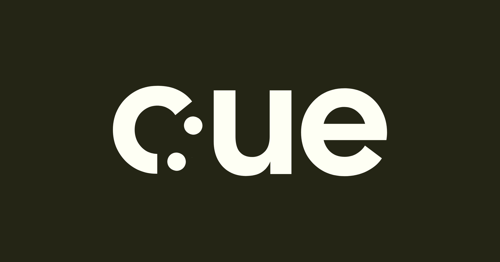

# cue brand kit

The brand as of 2026-11-13. The full kit, the demo-video components and the redesigned screens are in Figma: [cue — screen-share UI](https://www.figma.com/design/pQJ3RozRANVUBLTkeXndZf) (pages *Brandkit*, *Demo components*, *Baseline v2 (brand)*, *Logo exports*).

## Logo

Three versions of one shape. The mark is a **c** followed by a colon: cue has something to say, and it says it on screen, not out loud.

| Version | Use it for | File stem |
|---|---|---|
| Lockup `c:ue` | The default | `cue-lockup` |
| Mark `c:` | Avatars, the bot tile, favicons, anywhere small | `cue-mark` |
| Wordmark `cue` | Running text, or when the mark is already nearby | `cue-wordmark` |

- `logo/svg/transparent/`, `logo/png/transparent/`: each version in ink, cream, blue and lime, on no background. PNGs are 4×.
- `logo/svg/background/`, `logo/png/background/`: each version on ink, cream, blue and lime. The mark is 512 px square, the others 1200 × 630, and the PNGs are 2×.
- `public/logo.svg` (cream lockup, for cue's dark screen), `public/logo-light-bg.svg` (ink lockup) and `public/logo-mark.svg` (lime mark) are the copies the page can load.

Rules:

- One color per logo. Don't move the colon, stretch it, or add effects.
- Clear space on every side is at least the height of one colon dot.
- Minimum size: mark 24 px tall, lockup 96 px wide, wordmark 64 px wide.
- The lime logo disappears on paper (1.1:1). Lime goes on ink or blue.

## Color

| Name | Hex | Job |
|---|---|---|
| Cue Blue | `#3168B0` | cue's voice: status, links, diagram lines, numbers |
| Highlighter | `#DDFF8F` | Research highlights, captions, "found it" moments. Never text on paper |
| Paper | `#FEFFF4` | Backgrounds for slides, research and docs |
| Ink | `#242515` | Text, and the dark screen cue shows while it listens |
| Ink Muted | `#6B6C5C` | Secondary text |
| Line | `#E4E6D6` | Borders on paper |

Roughly 55% paper, 30% ink, 10% blue, 5% lime.

Contrast (WCAG): ink on paper 15.4:1, lime on ink 13.9:1, blue on paper 5.6:1 (AA). Blue on ink is only 2.8:1, so don't use it for text there.

The same values are in [`tokens.css`](tokens.css) as CSS variables.

## Type

- **Cal Sans** for headlines, slide titles and the wordmark. One weight.
- **Lato** for everything people read: body text, bullets, captions, labels.
- **JetBrains Mono** for things that are literal: URLs, sources, timestamps.

On the 1280 × 720 call screen: titles are Cal Sans 56 or larger, body text is Lato 28, captions are Lato Bold 32, and sources are mono 20 to 24. In gallery view the screen shrinks to about 320 × 180, so nothing goes below 24 px.

## Voice

cue never talks in the call, so every word it puts on screen has to earn its place.

- **Quiet:** show, don't announce. No greetings or "I'm here to help".
- **Short:** one line per caption, with the answer first: "Found it: about $9.2B in 2025, growing ~9% a year."
- **Plain:** no hype and no "As an AI". Use numbers and names instead of adjectives.

The kit writes the name in lowercase, *cue*. The README and code still say *Cue*; that decision is open.
